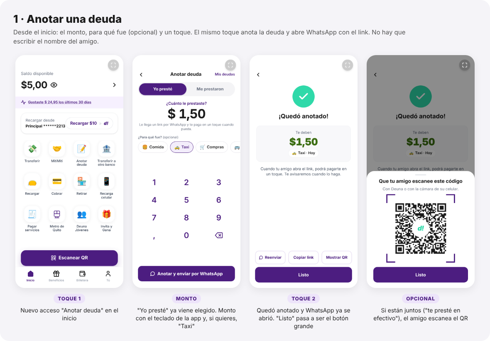
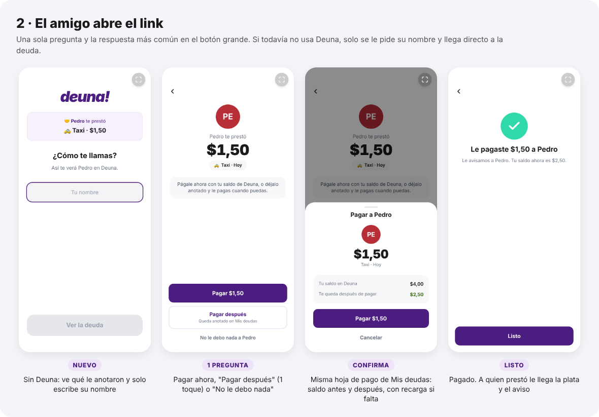
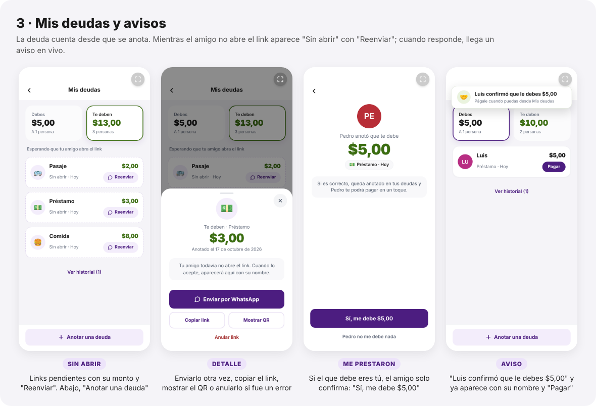

# Anotar deuda: préstamos entre amigos con link de pago

> "Te presté $1,50 para el taxi." Esa deuda nace fuera de una sala de MitiMiti: en efectivo o por transferencia. Ahora se anota en dos toques y el amigo la recibe como un link por WhatsApp para pagarla en un toque.
>
> **Fecha:** 17 de octubre de 2026 · **Alcance:** `src/mitimiti/` (pantallas nuevas y Mis deudas), `src/App.tsx` (inicio y usuarios nuevos) y `supabase-setup.sql` (sección 7).

---

## Resumen

| | |
|---|---|
| **Problema** | Las deudas solo existían si nacían en una sala de MitiMiti. El préstamo más común, "te presté $1,50", seguía en la memoria de alguien o en un chat. |
| **Solución** | **Anotar deuda**, desde el inicio o desde Mis deudas. Escribes el monto, eliges para qué fue (opcional) y tocas un botón. La deuda queda anotada y se abre WhatsApp con el link. |
| **Del otro lado** | El amigo abre el link y ve "Pedro te prestó $1,50". Puede tocar **Pagar** (con la misma hoja de pago y recarga de Mis deudas) o **Pagar después**, que la deja anotada. |
| **Las dos direcciones** | "Yo presté" (te deben) y "Me prestaron" (debes). En el segundo caso el amigo solo confirma: "Sí, me debe $5,00". |

**Pasos, medidos:**

| Tarea | Toques |
|---|---|
| Anotar "le presté $1,50 para el taxi" y enviarlo por WhatsApp, desde el inicio | **2** + el monto (y 1 opcional para "Taxi") |
| El amigo paga al instante | **2** (Pagar → confirmar) |
| El amigo lo deja anotado para pagar después | **1** |
| El amigo confirma que tú le debes ("Me prestaron") | **1** |
| El amigo todavía no usa Deuna | + escribir su nombre, y llega directo a la deuda |
| Reenviar un link que nadie abrió | **1** ("Reenviar" en la fila) |

---

## 1. Anotar una deuda



**Decisiones de diseño:**

- **Una sola pantalla**, igual que crear una sala. "¿Quién prestó?" ya viene elegido:
  - Desde el inicio, "Yo presté", que es el caso de un link de cobro.
  - Desde Mis deudas, el de la pestaña en la que estás: desde "Debes", "Me prestaron".
- **No se escribe el nombre del amigo.** Él queda anotado con su propio perfil al abrir el link, y en WhatsApp ya lo eliges de tus chats. Pedirlo sería un campo de texto con el teclado del sistema que no aporta nada.
- **"¿Para qué fue?" es opcional**, con un toque: Comida, Taxi, Compras, Pasaje, Recarga, Entradas, Gasolina u "Otro". Sin concepto, la deuda se ve como "Préstamo".
- **El mismo toque anota y comparte** ("Anotar y enviar por WhatsApp"). Si el navegador bloquea WhatsApp, la pantalla siguiente dice "Falta un paso: envíale el link a tu amigo" y ofrece el botón. Una vez enviado, el botón grande pasa a ser **"Listo"**.
- **Copiar link** sirve para otros chats. **Mostrar QR** sirve cuando están juntos: "te presté en efectivo y aquí mismo lo anotamos". El QR se puede leer con el escáner de Deuna o con la cámara del celular.

## 2. El amigo abre el link



- **Una pregunta por pantalla, con la respuesta más común en el botón grande:**
  - Si te prestaron: **Pagar $1,50**, **Pagar después** ("Queda anotado en Mis deudas") o el enlace discreto **"No le debo nada a Pedro"**.
  - Si alguien anotó que te debe: **Sí, me debe $5,00** o **"Pedro no me debe nada"**.
- **Pagar reutiliza la hoja de pago de Mis deudas.** Muestra el saldo antes y después y, si no alcanza, ofrece "Recargar $10 y pagar".
- **"No le debo nada"** evita que alguien quede con una deuda que no reconoce. Quien la anotó recibe el aviso ("Juan dice que no te debe $2,00 · Quizás ya lo arreglaron") y la deuda pasa a su historial.
- **Usuario nuevo:** el link sobrevive al registro, igual que la invitación a una sala. Ve "🤝 Pedro te prestó · 🚕 Taxi · $1,50", escribe su nombre y llega directo a la deuda.
- **Casos borde con su propia pantalla**:
  - Link que ya usó otra persona.
  - Link anulado.
  - Link inexistente.
  - Tu propio link, que muestra si el amigo ya respondió.
  - Una deuda que ya pagaste.

## 3. Mis deudas y avisos



- **La deuda cuenta desde que se anota.** La plata se debe igual aunque el amigo no haya abierto el link, así que suma en "Te deben" o "Debes", en Mis deudas y en el inicio.
- Mientras nadie abre el link, aparece en **"Esperando que tu amigo abra el link"** como **"Sin abrir"**, con **Reenviar**. Al tocarla puedes enviarla otra vez, copiar el link, mostrar el QR o **anularla** si te equivocaste.
- Cuando el amigo responde, la fila pasa a ser la de una persona, igual que las deudas de sala. Tiene **Pagar**, **Recordar**, **Ya me pagó** y **Perdonar**.
- **Avisos en vivo** en cualquier pantalla:
  - "Juan aceptó: te debe $1,50".
  - "Luis confirmó que le debes $5,00".
  - "Juan te pagó $1,50 · Ya está en tu saldo de Deuna".
  - Si respondieron varios mientras no mirabas, un solo aviso: "Respondieron 2 de tus links".
- Abajo, siempre a mano: **"Anotar una deuda"**.

---

## Modelo de datos

Se reutiliza `mitimiti_debts`. Así Mis deudas, pagar, recordar, "Ya me pagó", perdonar, el historial y el "te pagaron" funcionan igual para las dos clases de deuda.

| Columna nueva | Para qué |
|---|---|
| `kind` | `'room'` (nació en una sala) o `'direct'` (anotada a mano) |
| `concept` | Para qué fue ("Taxi"); opcional |
| `invite_token` | El token del link que se comparte (único) |
| `created_by` | Quién la anotó |
| `responded_at` | Cuándo el amigo la aceptó o dijo que no |

Además, `room_id` pasa a aceptar `NULL` y se agrega el estado `declined`.

Quien anota queda en su lado de la deuda. El lado del amigo queda en `''` hasta que abre el link. La respuesta es condicional (`status = 'pending'` y el lado sigue vacío): si dos personas abren el mismo link, solo la primera se queda con la deuda.

```
pending ──(el amigo acepta)──▶ active ──▶ paid / forgiven
   │ └──(el amigo no la reconoce)──▶ declined
   └──(quien la anotó anula el link)──▶ cancelled
```

> ⚠️ **Acción necesaria:** ejecuta la **sección 7 de `supabase-setup.sql`** en el SQL Editor de Supabase. También se puede correr el archivo completo, que es idempotente. Hasta entonces, la app sigue funcionando como antes y solo falla "Anotar deuda": muestra un error y deja el motivo en la consola.

Las deudas de sala no cambian: sus `pending` siguen siendo promesas dentro de la sala y no aparecen en Mis deudas. Las anotadas a mano sí aparecen desde que se crean, y `kind` es lo que las distingue.

**Métricas nuevas** en `mitimiti_metrics`:

- `DEBT_LINK_CREATED`
- `DEBT_LINK_SHARED`, con el canal: `whatsapp`, `copy` o `qr`
- `DEBT_LINK_OPENED`
- `DEBT_LINK_ACCEPTED`
- `DEBT_LINK_DECLINED`
- `DEBT_LINK_PAID_NOW`
- `DEBT_LINK_CANCELLED`

Con ellas se mide la conversión de links enviados a links abiertos y pagados, y cuántos amigos llegan a Deuna por un link.

## Cómo se probó

- **Migración en PostgreSQL 16:**
  - Se aplicó sobre el esquema anterior, dos veces seguidas para confirmar que es idempotente.
  - Las deudas de sala existentes se conservan.
  - La restricción `kind` rechaza filas inconsistentes y el token es único.
  - Una segunda respuesta al mismo link no toca nada, y `mitimiti_expire_rooms()` sigue funcionando.
- **24 verificaciones end to end en Chrome**, con 3 teléfonos y un backend simulado en memoria, sin escribir en Supabase:
  - Anotar en las dos direcciones, con el mensaje de WhatsApp y el link.
  - Copiar y QR.
  - Usuario nuevo que llega por el link.
  - Pagar al instante: se descuenta del deudor y se acredita al acreedor.
  - Pagar después y pagar con recarga.
  - Confirmar, rechazar y anular.
  - Link usado por otro y link propio.
  - Avisos en vivo e historial.
  - Pantalla chica (iPhone SE).
  - Crear una sala de MitiMiti sigue funcionando.
- **Typecheck, lint y build de producción:**
  - `tsc` sin errores.
  - `eslint` con los mismos 12 errores que ya existían y ninguno nuevo.
  - El build compila.

**Qué no se probó:** contra el Supabase real ni el *realtime* entre teléfonos, a propósito, para no escribir datos de prueba. Antes de la demo conviene una pasada con 2 celulares.

## Hoja de ruta

| Prioridad | Propuesta | Por qué |
|---|---|---|
| Alta | **Seguridad (RLS)**. Como el resto de MitiMiti, hoy las políticas son `USING (true)`. | Quien tenga el link puede responderlo. Para un MVP basta; en producción, la identidad debe venir de la sesión de Deuna. |
| Media | Recordar un link "Sin abrir" después de unos días, con un aviso a quien lo anotó | Hoy hay que acordarse de tocar "Reenviar" |
| Media | Pagos parciales ("te pago $1 ahora y $0,50 después") | Común en préstamos chicos |
| Baja | Elegir el contacto dentro de Deuna en vez de WhatsApp, cuando el amigo ya usa Deuna | Notificación push en vez de un link |
