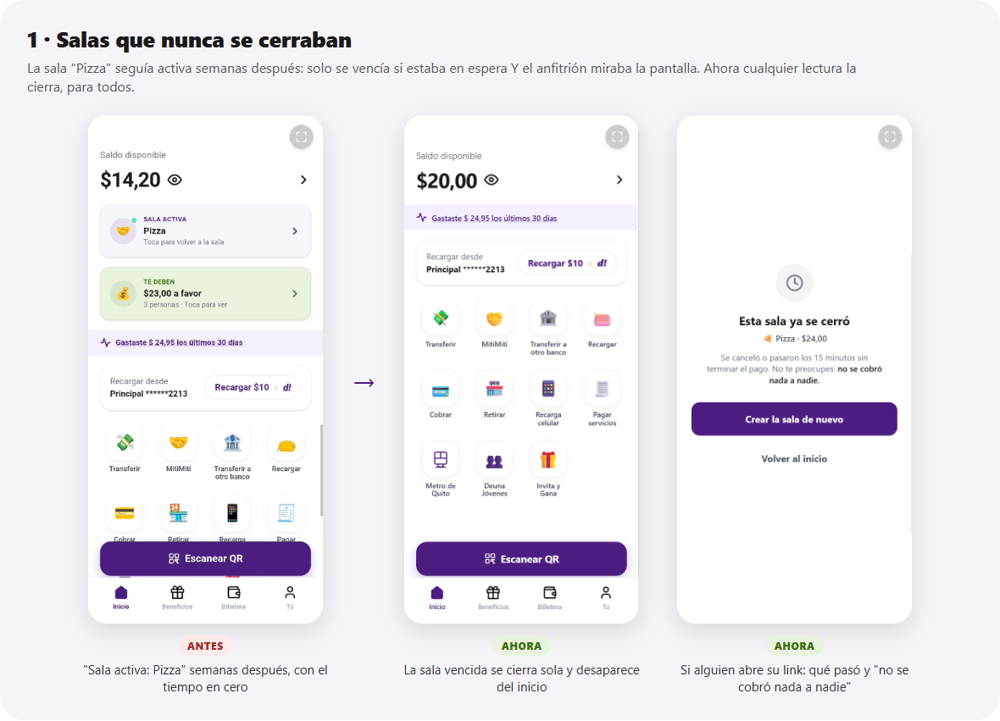
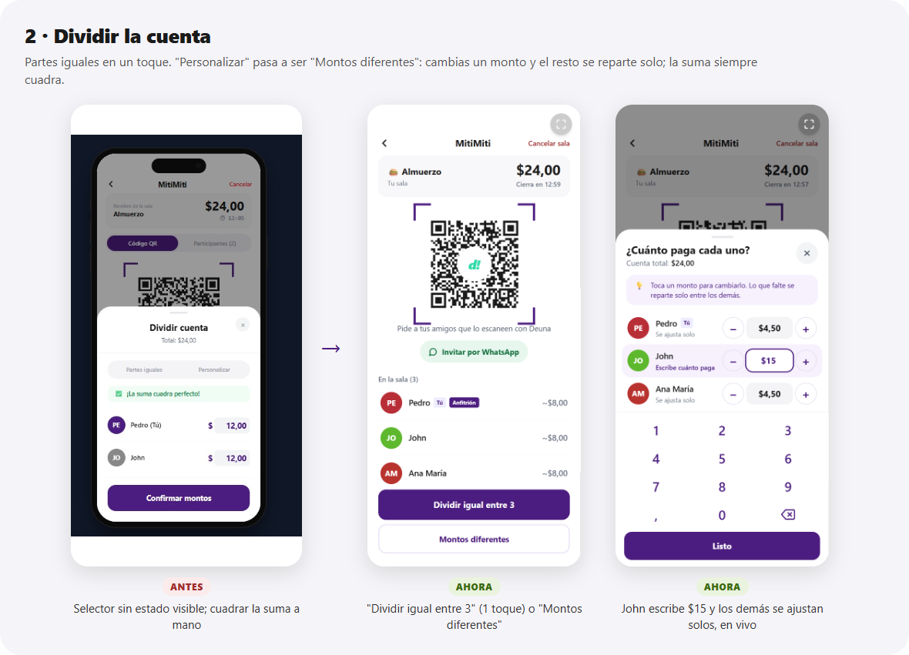
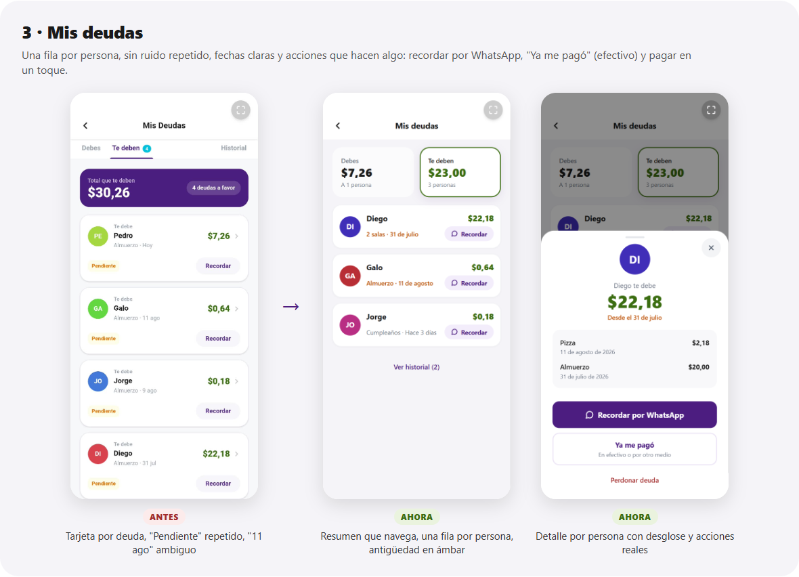
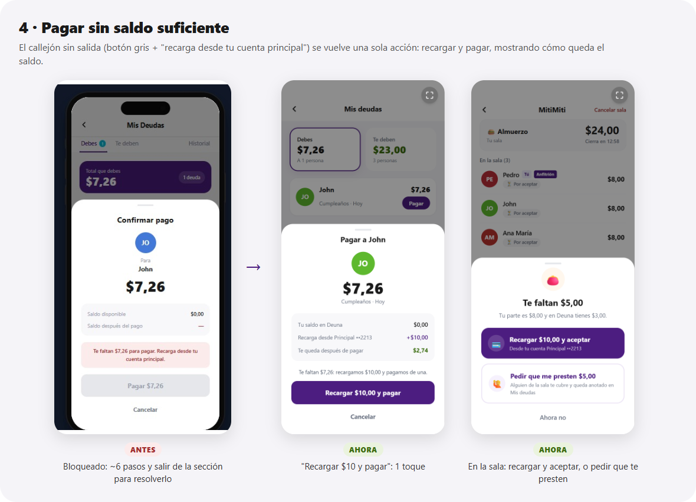
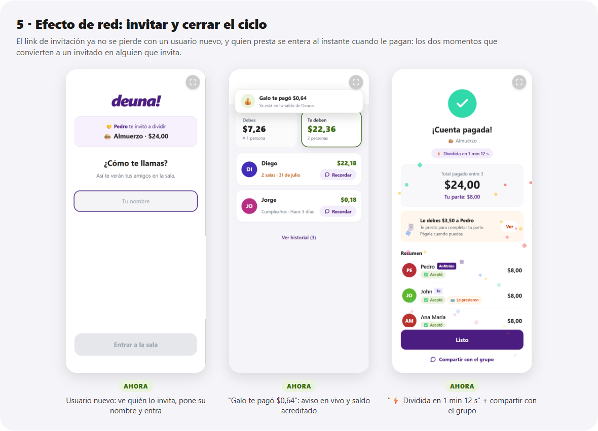

# MitiMiti — Auditoría UX y rediseño

> Divide cuentas, no amistades. Esta auditoría revisa paso a paso toda la experiencia de MitiMiti: crear la sala, invitar, dividir, aceptar, prestar, pagar, el cierre y las deudas. Para cada hallazgo indica el problema, por qué importa para el usuario de Deuna (desde jóvenes nativos digitales hasta adultos mayores con poca práctica) y qué se hizo.
>
> **Fecha:** 14 de octubre de 2026 · **Alcance:** módulo `src/mitimiti/` + inicio de la app (`src/App.tsx`).

---

## Resumen ejecutivo

**Los tres puntos que levantaste, resueltos:**

| Tema | Qué pasaba | Qué hace ahora |
|---|---|---|
| **Salas que no se cierran** | El vencimiento solo ocurría si la sala estaba *en espera* **y** el anfitrión tenía la pantalla abierta. La sala "Pizza" de tu captura quedó en `confirming` el 29 de agosto y nunca se cerró. En la BD había **31 salas abiertas y vencidas**. | Cualquier lectura de una sala vencida la cierra en la BD, para todos. El inicio limpia las salas viejas del usuario. Un QR o link vencido ya no sirve. Quien abre la sala ve qué pasó y que **no se cobró nada**. |
| **Personalizar montos** | Hoja obligatoria incluso para partes iguales. Selector sin estado visible. "Personalizar" no dice qué hace. El anfitrión tenía que cuadrar la suma a mano. | **Partes iguales en 1 toque.** "Personalizar" pasa a ser **"Montos diferentes"**: cambias un monto y **el resto se reparte solo**, así que la suma siempre cuadra. Hay botones −/+ de $1 y el teclado propio de la app. Si te equivocaste, puedes **corregir después de dividir**. |
| **Mis deudas** | Una tarjeta por deuda y no por persona, con ruido repetido ("Te debe", "Pendiente"). "Recordar" no enviaba nada. Sin saldo, el pago era un callejón sin salida. "11 ago" era ambiguo. | **Una fila por persona.** El resumen sirve de navegación. **Recordar por WhatsApp** con mensaje y link. **"Ya me pagó"** para pagos en efectivo. **"Recargar $10 y pagar"** en un toque. Quien prestó **recibe el dinero y un aviso**. |

**Lo que encontré además (bugs que nadie había reportado):**

1. **El link de invitación se perdía con usuarios nuevos.** Alguien sin Deuna abría la invitación, caía en "Ingresar", ponía su nombre… y la sala ya no estaba. Es justamente el camino del efecto de red.
2. **"Reintentar" después de un pago fallido nunca funcionaba**: siempre respondía "No todos han confirmado". Y al fallar se anulaban los préstamos de la sala, así que un reintento exitoso los perdía.
3. **Quien prestaba nunca recibía su dinero.** Cuando el deudor pagaba, se descontaba de su saldo, pero no se sumaba al del acreedor, y este no se enteraba.
4. En el modal "No te alcanza", el botón **"Salir de la sala" solo cerraba el modal**.
5. **"Pagar" se disparaba dos veces en el celular** (eventos táctiles más eventos de mouse).
6. Las **animaciones de todas las hojas no existían**: las clases se usaban, pero nunca se definieron.

**Menos pasos, medidos:**

| Tarea | Antes | Ahora |
|---|---|---|
| Dividir en partes iguales (anfitrión, de "todos adentro" a "pagado") | 4 toques | **2** |
| 3 personas, $24, Ana paga $5 y el resto igual | ≈ 28 toques **y una división de cabeza** | **5 toques, cero cálculo** |
| Corregir un monto después de dividir | Imposible: cancelar y que todos vuelvan a escanear | **3 toques** |
| Pagar una deuda sin saldo suficiente | ≈ 6 toques en 3 pantallas | **2 toques** |
| Persona nueva que llega por invitación | 4+ pasos y depende de que el anfitrión siga ahí | **1 paso** (su nombre) |
| Crear sala desde MitiMiti | 3 toques + teclado del sistema | **1 toque** (nombre sugerido) |
| Crear sala escaneando el QR del local | 2 toques | **1 toque** |
| Recordarle a alguien que te debe | 1 toque que **no hacía nada** | 1 toque que abre WhatsApp con el mensaje listo |

---

## Cómo se evaluó

- **Recorrido completo del código** de cada pantalla, en cada combinación de rol (anfitrión o participante) y estado de la sala (`waiting` → `locked` → `confirming` → `processing` → `completed` / `failed` / `cancelled`).
- **Consulta de solo lectura a Supabase** para confirmar el bug de vencimiento: 31 salas abiertas y vencidas (30 en `waiting` y 1 en `confirming`, la "Pizza").
- **Pruebas:**
  - 12 tests de la lógica de reparto, incluido un *fuzzing* de 3.000 casos aleatorios.
  - 20 flujos completos en un Chrome real, con un backend simulado en memoria (sin escribir en tu BD), con capturas en tamaño de teléfono.
  - Typecheck, lint y build de producción.
- **Principios aplicados:**
  1. **Una decisión por pantalla.** Abajo siempre hay un estado claro y una sola acción principal.
  2. **Valores por defecto inteligentes.** Partes iguales, el nombre de la sala, el monto de la recarga.
  3. **La app hace la cuenta, nunca la persona.**
  4. **Con dinero, transparencia y confirmación.** El saldo antes y después siempre visible; las acciones irreversibles se confirman.
  5. **Lenguaje humano.** Nada de "Host", "Liquidar", "2+" ni "Personalizar".
  6. **Cerrar cada ciclo.** Toda acción tiene respuesta visible: "Diego se unió", "Galo te pagó", "no se cobró nada".

---

## 1. Salas que no se cierran (reportado)

### Diagnóstico

Había tres huecos que se sumaban:

1. **El vencimiento solo existía en la pantalla.** Cuando `RoomTimer` llegaba a 0, `RoomView` cancelaba la sala **solo si estaba en `waiting` y solo si quien miraba era el anfitrión**. Una sala vencida en `locked` o `confirming`, o con el anfitrión fuera de la app, nunca se cerraba.
2. **El aviso del inicio filtraba mal.** `getActiveRoomForUser` descartaba las salas vencidas en `waiting`, pero **mostraba siempre las `locked`/`confirming`**, aunque hubieran vencido hace semanas. Por eso aparecía "Sala activa: Pizza".
3. **La entrada no revisaba el vencimiento.** `enterRoomByToken` solo miraba `status === 'waiting'`: el QR de cualquiera de esas 30 salas zombi seguía funcionando.

### Solución (implementada)

- **Cierre al leer** (`src/mitimiti/supabase.ts` → `expireRoom` / `closeIfStale`). Toda lectura de una sala (`getRoom`, `getRoomByToken`, `getActiveRoomForUser`) que la encuentra abierta y vencida la marca `cancelled` en la BD y anula sus préstamos pendientes. La actualización es **condicional** (`status IN (abiertas) AND expires_at <= now`): si dos teléfonos lo intentan a la vez, solo uno lo hace, y nunca pisa una sala que justo se pagó.
- **Cualquiera cierra al vencer.** El timer cierra la sala en cualquier estado abierto, quien sea que la esté mirando.
- **Barrido en el inicio.** Al abrir el inicio se cierran las salas vencidas del usuario, así que la "Pizza" desaparece la primera vez que abre la app.
- **Pantalla de cierre honesta** (`RoomClosedView`). "Se acabó el tiempo de la sala · Pasaron 15 minutos sin terminar el pago. No te preocupes: **no se cobró nada a nadie**". El anfitrión tiene **"Crear la sala de nuevo"**, con el monto y el nombre ya cargados: la cuenta sigue sin pagar y no tiene que volver a escribirla.
- **No se borra la fila.** `mitimiti_debts` tiene `ON DELETE CASCADE` hacia la sala, así que borrarla borraría el historial de deudas. Marcarla `cancelled` la hace desaparecer de la app sin perder trazabilidad.
- **Opcional, en el servidor:** `supabase-setup.sql` trae la función `mitimiti_expire_rooms()` y el `cron.schedule` de `pg_cron`, para cerrarlas aunque nadie abra la app.

> **Acción sugerida:** ejecuta una vez `SELECT mitimiti_expire_rooms();` en el SQL Editor de Supabase (después de crear la función) para limpiar de golpe las 31 salas zombi actuales. Si no, se irán cerrando a medida que cada usuario abra la app.

**Duración:** se mantuvo en 15 minutos. Un flujo normal (entrar, dividir, aceptar y pagar) toma de 2 a 5 minutos, y con un préstamo de por medio, 1 o 2 más. El contador ahora dice **"Cierra en 12:59"** en vez de un "⏱ 13:05" sin contexto, y se pone ámbar en los últimos 5 minutos y rojo en el último.

---

## 2. Dividir la cuenta y "Personalizar" (reportado, foco principal)

### Qué estaba mal

| # | Hallazgo | Por qué importa |
|---|---|---|
| 1 | "Listo" abría una hoja obligatoria, había que confirmar "Confirmar división igual" y después el anfitrión además tenía que tocar "Acepto $12" | Tres toques para el 90% de los casos, que es partes iguales |
| 2 | "Listo" no dice qué va a pasar | La persona mayor no sabe si "Listo" cierra, paga o divide |
| 3 | **El selector "Partes iguales / Personalizar" no mostraba cuál estaba activo** (se ve en tu captura). Causa: la clase `mitimiti-toggle-slider` no tenía estilos, y `.mitimiti-toggle-btn` (CSS sin capa) le ganaba al `text-*` de Tailwind v4 | No se sabe en qué modo estás |
| 4 | "Personalizar" es un modo abstracto | No dice el resultado ("cada uno paga distinto") |
| 5 | **El anfitrión cuadraba la suma a mano**: al cambiar un monto aparecía "Faltan $3 por asignar" y había que recalcular a los demás | Vuelve justo la calculadora que MitiMiti promete quitar |
| 6 | Campos de 80 px con el teclado del sistema, que tapa la hoja; hay que borrar el "12,00" antes de escribir | Mucha fricción motriz, sobre todo en personas mayores |
| 7 | El avatar del primero era morado y el de los demás gris, distinto del color de la misma persona en la sala | Se pierde el reconocimiento visual |
| 8 | No se podía corregir después de dividir | Un error obligaba a cancelar todo y que todos volvieran a escanear |
| 9 | La nota "diferencia máxima de $0,01" salía también con montos personalizados | Información falsa |

### Decisiones de diseño

**Nombre: "Montos diferentes".** Es el par natural de "partes iguales" y describe el *resultado*, no el mecanismo. Opciones descartadas:

- "Personalizar": demasiado abstracto.
- "Por consumo": hace pensar en ítems de la cuenta.
- "Cada uno paga distinto": muy largo para un botón.
- "Ajustar montos": correcto, pero menos claro que "diferentes".

Además ya **no es un modo**: no hay selector. Es una hoja con el reparto igual ya puesto, donde tocas el monto que quieras cambiar.

**¿Quién puede cambiar montos? Solo el anfitrión, y cada persona acepta el suyo.** Razones:

- **Una sola fuente de verdad.** Con varias personas editando a la vez, la suma no cerraría nunca y aparecerían conflictos y esperas.
- **Así funciona en la mesa.** Quien tiene la cuenta en la mano la lee en voz alta y reparte.
- **El consentimiento ya está en el "Acepto pagar $X"** de cada uno. Nadie paga un monto que no vio: además, si el anfitrión cambia los montos en el momento en que alguien acepta, la BD rechaza la aceptación con "Tu monto acaba de cambiar".
- **Si alguien no está de acuerdo, se resuelve en 3 toques**, sin reiniciar: "Corregir montos" → cambio → "Guardar montos". Todos vuelven a aceptar y reciben un aviso: "Pedro cambió los montos. Ahora te toca $7,00".

**Auto-reparto** (`src/mitimiti/splitMath.ts`, con tests):

1. Lo que el anfitrión toca queda fijo.
2. Lo que falta para el total se reparte en partes iguales entre los que no se tocaron.
3. **Siempre queda al menos una persona libre** que absorbe la diferencia. Con 2 personas, cambias a una y la otra se ajusta sola.
4. Si los montos fijados superan la cuenta, se liberan los que se tocaron hace más tiempo. **La última edición manda.**
5. Solo si **un solo** monto supera la cuenta aparece "Te pasaste por $X", con el botón inactivo.

**Interacción pensada para todas las edades:**

- **−/+ de a $1**, el mismo patrón del carrito de compras de las apps de delivery, que todos conocen. El primer toque redondea al dólar ($16,67 → $17,00).
- **El teclado propio de MitiMiti** (el mismo de "¿Cuánto es la cuenta?") en vez del teclado del sistema. El monto anterior queda en gris como guía y se escribe encima, sin borrar nada.
- Mientras escribes, **los demás se reajustan en vivo** con un destello suave. Es el "momento wow" de la demo.
- Cada persona tiene su **"↺ Deshacer"**, y hay un **"Volver a partes iguales"** general.
- El botón describe la acción: "Dividir en partes iguales" si no cambiaste nada y "Cobrar estos montos" si sí.

**El anfitrión acepta su parte en el mismo toque en que divide**, si su saldo alcanza. Si no alcanza, se le abren de inmediato las opciones para cubrir lo que falta. Ya no hay un "¿Aceptas?" justo después de haber puesto él mismo los montos.

**Monto $0 = "No paga".** Al cumpleañero al que invitan queda aceptado solo, con la etiqueta 🎁.

---

## 3. Mis deudas (reportado, foco principal)

### Qué estaba mal

| # | Hallazgo (en tus capturas) | Por qué importa |
|---|---|---|
| 1 | **Una tarjeta por deuda, no por persona.** Si Diego te debe de dos salas, son dos tarjetas. El inicio decía "3 personas" contando *deudas* | La gente piensa en personas: "Diego me debe $22" |
| 2 | "Te debe" encima de cada nombre (ya estás en "Te deben") y el chip **"Pendiente" en todas** (todo lo de esa lista está pendiente por definición) | Ruido. Tarjetas altas: solo caben 4 |
| 3 | **"11 ago"**: muchos lo leen como el *ago* inglés ("hace 11") | Ambigüedad en dinero = desconfianza |
| 4 | **"Recordar" solo mostraba un aviso local**, no le llegaba nada a nadie | Una promesa rota; el usuario cree que recordó |
| 5 | **No había "Ya me pagó"**. Si te pagaban en efectivo, lo único posible era "Perdonar" | Obliga a registrar algo falso |
| 6 | **Sin saldo, callejón sin salida** (tu captura 5): botón gris y "Recarga desde tu cuenta principal" | ≈ 6 pasos fuera de la sección para resolverlo |
| 7 | **El que prestaba nunca recibía el dinero en su saldo** ni se enteraba del pago | Rompe la confianza en prestar, que es el diferenciador |
| 8 | La tarjeta resumen era morada para "Debes" y para "Te deben"; badges cian fuera de la marca; "Historial" separado a la derecha | La dirección del dinero no se lee de un vistazo |
| 9 | "Referencia: ABC123" de estilo bancario | Ruido en una deuda entre amigos |
| 10 | En la sala, "Liquidar" (jerga) pagaba con **un solo toque** y avisaba con un `alert()` | Mover dinero sin confirmación y en lenguaje técnico |

### Rediseño (implementado)

- **El resumen es la navegación.** Dos tarjetas: "Debes $7,26 · A 1 persona" y "Te deben $23,00 · 3 personas" (en verde). Se abre en la que tiene algo que hacer, y desde el inicio se llega directo a la pestaña correcta.
- **Una fila por persona:** nombre, sala o salas y fecha, monto y una acción directa (**Pagar** o **Recordar**). Si la deuda tiene más de 7 días, la fecha se pinta en ámbar.
- **Detalle por persona** con el desglose por sala y fechas claras ("31 de julio de 2026").
- **Recordar por WhatsApp**, con un mensaje amable y sin tono de cobro: *"¡Hola Diego! 👋 Te recuerdo los $22,18 de «Pizza» y «Almuerzo». Cuando puedas, págame en un toque desde Deuna 💜 [link]"*. Después queda "✓ Recordado hoy", para no insistir de más.
- **"Ya me pagó · En efectivo o por otro medio"**, con confirmación. No mueve dinero; solo cierra la deuda. "Perdonar deuda" queda como acción terciaria.
- **Pagar con recarga incluida:** "Te faltan $7,26: recargamos $10,00 y pagamos de una", mostrando el saldo actual, la recarga y lo que te queda.
- **"Galo te pagó $0,64 · Ya está en tu saldo de Deuna":** aviso en vivo en cualquier pantalla, con el saldo acreditado al prestamista una sola vez por deuda (nunca las que él mismo marcó como "Ya me pagó"). En la demo el saldo vive en cada teléfono, así que lo acredita el teléfono del prestamista; en producción lo haría el backend de Deuna.
- **Estados vacíos humanos:** "Estás al día 🎉 · No le debes nada a nadie".
- En la sala, el aviso contextual "Le debes $3,50 a Pedro · **Pagar**" usa la misma hoja de pago con confirmación.

---

## 4. Pagar sin saldo (tu captura 5) y "No te alcanza"

- **En deudas:** "Recargar $10 y pagar", en un toque. La recarga sube en saltos de $10, igual que el botón del inicio: si faltan $13, se recargan $20.
- **En la sala** ("Te faltan $5,00 · Tu parte es $8,00 y en Deuna tienes $3,00"), hay dos salidas reales:
  - **"Recargar $10 y aceptar"**, desde la cuenta Principal ••2213, sin deuda.
  - **"Pedir que me presten $5,00"**: alguien de la sala te cubre y queda anotado en Mis deudas.
  - El falso "Salir de la sala", que solo cerraba el modal, pasa a ser "Ahora no".
- Mientras se espera un préstamo también aparece **"Mejor recargo $10 y acepto"**, por si nadie presta.

---

## 5. Auditoría del resto del flujo, paso a paso

Leyenda: ✅ implementado · 🗺️ propuesto (ver hoja de ruta).

### 5.1 Inicio
- ✅ **"Sala activa" dice qué falta** en vez de "Toca para volver a la sala": "Falta que aceptes $12,00", "¡Todos aceptaron! Toca para pagar", "Esperando a que Pedro divida la cuenta".
- ✅ "Te deben $22,82 · **2 personas**" cuenta personas, no deudas.
- ✅ **El saldo es el mismo en todas las pantallas.** Antes el inicio solo releía el saldo al volver a él.
- 🗺️ Si debes **y** te deben, hoy solo se ve "Debes". Propuesta: un solo aviso que diga "Debes $7 · Te deben $23".

### 5.2 Crear la sala
- ✅ **El nombre se elige en la misma pantalla del monto**, con chips y uno sugerido según la hora: Almuerzo, Café o Cena. Se elimina el modal "Nombra tu sala", que además abría el teclado del sistema encima de las sugerencias. Un nombre propio se escribe con "✏️ Otro nombre".
- ✅ "¿Cuánto es la cuenta?" va con una línea que explica el resto: "Después tus amigos escanean tu código y cada uno acepta su parte". Es la única explicación que necesita quien lo usa por primera vez.
- ✅ "Mis deudas" pasa a ser un enlace en el encabezado. Antes había dos botones grandes que competían con "Crear sala".
- ✅ Si la sala no se puede crear, se ve un error. Antes solo iba a la consola y el botón parecía no hacer nada.
- ✅ Escaneando el QR del local, **"🤝 Dividir cuenta" crea la sala directo** con el nombre del local. El botón decía "MitiMiti", que no dice nada a quien no conoce la marca.

### 5.3 Sala: anfitrión esperando a que lleguen
- ✅ **Una sola vista** con el QR y la lista en vivo. Se quitaron las pestañas "Código QR / Participantes", que repetían la misma lista.
- ✅ **"Invitar por WhatsApp"**, con un mensaje listo: *"Únete a mi sala «Almuerzo» para dividir la cuenta ($24,00)…"*. El QR y el link ahora usan la misma URL; antes podían no coincidir.
- ✅ Avisos de **llegada y salida**: "Diego se unió", "John salió de la sala".
- ✅ **"Cancelar sala" pide confirmación**: "Se cerrará para todos y no se le cobrará nada a nadie". Antes era un texto rojo que cancelaba con un toque.
- ✅ Se quitó "Añadir desde contactos", que solo mostraba un `alert` de simulación.
- ✅ Los montos estimados se ven como "~$8,00", sin el chip "⏳ Pendiente" que antes salía cuando nadie podía aceptar todavía.

### 5.4 Sala: participante
- ✅ Antes, **el único botón era "Salir de la sala"** (una acción negativa como principal) y nada decía qué esperar. Ahora: "⏳ Esperando a que Pedro divida la cuenta · Por ahora te tocaría ~$8,00", y "Salir" queda como enlace secundario.
- ✅ "Acepto pagar $9,00", junto con "Pedro puso montos diferentes para cada uno" cuando corresponde.
- ✅ Salir de una sala ya dividida pide confirmación ("Pedro tendrá que volver a dividir la cuenta entre los demás").
- ✅ "Host" pasa a "**Anfitrión**", y los estados son "Por aceptar", "Aceptó", "No paga" y "Necesita ayuda".

### 5.5 Préstamos dentro de la sala (el diferenciador)
- ✅ Se mantiene el flujo. Quien pide ve "Esperando ayuda" con el progreso; quien puede prestar ve "Le faltan $3,50 · Puedes prestar hasta $3,50" (nunca más de lo que le sobra después de su propia parte).
- 🗺️ En vez de un campo libre, botones de monto sugerido ("Todo lo que falta", "La mitad"), como en el resto de la app.

### 5.6 Pago final (anfitrión)
- ✅ "🎉 ¡Todos aceptaron! · Paga y listo: a cada uno se le descuenta su parte" → "Pagar $24,00".
- ✅ Se corrigió el doble disparo en el celular (*pointer events*) y se mantiene el truco de demo de mantener presionado 2 segundos para simular un fallo.
- ✅ **"Reintentar el pago" ahora funciona**, y los préstamos de la sala sobreviven al fallo. "Cancelar la sala" aclara que no se cobra nada.

### 5.7 Éxito
- ✅ "**¡Cuenta pagada!**" con un chip **"⚡ Dividida en 1 min 12 s"**: el dato que hace decir "wow".
- ✅ Muestra **quién le debe a quién en esta sala** ("Le debes $3,50 a Pedro · Te prestó para completar tu parte") en vez de un "Ver mis deudas" genérico.
- ✅ **"Compartir con el grupo"** por WhatsApp: *"✅ Dividimos «Almuerzo» ($24,00) entre 3 en 1 min 12 s con MitiMiti de Deuna, sin calculadora ni 'te transfiero luego' 💜"*.

### 5.8 Accesibilidad y lenguaje
- ✅ **Avatares:** antes había 3 fórmulas de color distintas y ahora hay una sola (`Avatar.tsx`). La luminosidad bajó de 55% a 45%: las iniciales blancas sobre verde o amarillo casi no se leían.
- ✅ "Liquidar" → "Pagar", "Host" → "Anfitrión" y "Necesitas 2+ personas" → "Con al menos 2 personas ya puedes dividir". Sin jerga financiera.
- ✅ Controles principales de 40 px o más (−/+, cerrar, acciones), `aria-label` en controles de íconos, `role="status"` en avisos y soporte de `prefers-reduced-motion`.
- 🗺️ Quedan textos secundarios de 11 a 12 px en gris claro en pantallas fuera de este alcance. Para personas mayores conviene un mínimo de 13 px y gris con contraste 4.5:1 o más.
- ✅ Animaciones reales de entrada para todas las hojas (antes aparecían de golpe).

---

## 6. Efecto de red: cómo MitiMiti trae usuarios nuevos

El ciclo de crecimiento tiene cinco momentos. Cada uno tiene que ser impecable:

1. **El anfitrión invita** (QR en la mesa o WhatsApp para quien no está). ✅ Botón de WhatsApp con mensaje y link.
2. **El invitado nuevo entra.** ✅ El link sobrevive al registro: "🤝 Pedro te invitó a dividir · 🍔 Almuerzo · $24,00 → ¿Cómo te llamas? → Entrar a la sala". Antes ese usuario se perdía.
3. **La experiencia sorprende.** ✅ Montos en vivo, reparto automático y "⚡ Dividida en 1 min 12 s".
4. **El grupo lo ve.** ✅ "Compartir con el grupo" en la pantalla de éxito, y los recordatorios llevan el link a Deuna.
5. **Quien prestó confía en volver a prestar.** ✅ "Galo te pagó $0,64", con el dinero en su saldo.

Para medirlo se agregaron eventos a `mitimiti_metrics`:

- `INVITE_SHARED`
- `SUCCESS_SHARED`
- `DEBT_REMINDER_SENT` (con canal)
- `DEBT_MARKED_PAID`
- `TOP_UP_IN_ROOM`
- `ROOM_EXPIRED`
- `ROOM_RESPLIT`

Con ellos se puede calcular el **coeficiente viral K**: invitaciones por sala multiplicadas por la conversión de invitados a usuarios que crean su propia sala.

---

## 7. Hoja de ruta (no implementado)

| Prioridad | Propuesta | Por qué |
|---|---|---|
| Alta | **Deep link real de Deuna**: si la app está instalada, abre la sala; si no, la tienda, con el token preservado (*deferred deep link*) | Hoy el link abre la demo web |
| Alta | **Recordatorio por notificación push de Deuna** (con "Pagar" en la notificación) cuando ambos usan Deuna; WhatsApp para el resto | No saca al usuario de la app y deja más clara la intención de pago |
| Alta | **Seguridad (RLS)**: hoy las políticas son `USING (true)` y cualquiera con la clave pública puede leer o editar salas y deudas | Imprescindible antes de producción; para la demo no es un problema |
| Media | Un solo aviso en el inicio cuando debes y te deben | Ver 5.1 |
| Media | Montos sugeridos al prestar | Ver 5.5 |
| Media | **"Proponer mi monto"**: el participante sugiere y el anfitrión aprueba en 1 toque | Delegar sin perder la fuente única de verdad |
| Media | **Dividir por ítems** con foto de la cuenta (OCR): cada uno toca lo que pidió | El caso "yo solo pedí una ensalada", resuelto sin cálculo |
| Media | Propina sugerida (10%) en la sala; `tip_cents` ya existe en el modelo | Muy común en restaurantes |
| Baja | **Compensar deudas cruzadas** (yo te debo $5 y tú me debes $3 → queda una de $2) | Menos movimientos |
| Baja | El anfitrión puede quitar a alguien que entró por error y extender 5 minutos | Casos borde reales |
| Baja | Cierre del lado del servidor con `pg_cron` (SQL ya incluido en `supabase-setup.sql`) | Salas que nadie vuelve a abrir |

---

## 8. Qué cambió en el código

**Sin migraciones de base de datos obligatorias.** Todo funciona con el esquema actual; lo único nuevo en SQL es la función opcional de vencimiento.

| Archivo | Cambio |
|---|---|
| `src/mitimiti/supabase.ts` | Vencimiento al leer (`expireRoom`, `closeIfStale`), `getActiveRoomForUser` con estado propio y limpieza, `lockRoom` sirve también para corregir montos y devuelve lo asignado, `confirmPayment` con monto esperado, reintento desde `failed`, `settleDebts` y `forgiveDebts` por lote |
| `src/mitimiti/splitMath.ts` *(nuevo)* | Lógica pura del auto-reparto |
| `src/mitimiti/debtGroups.ts` *(nuevo)* | Deudas agrupadas por persona |
| `src/mitimiti/share.ts` *(nuevo)* | Mensajes y links de WhatsApp (invitar, recordar, compartir) |
| `src/mitimiti/components/SplitEditorSheet.tsx` *(nuevo, reemplaza a `CustomSplitModal.tsx`)* | "¿Cuánto paga cada uno?" |
| `src/mitimiti/components/RoomView.tsx` | Estados claros por rol, dividir en 1 toque, aceptación automática del anfitrión, confirmaciones, vencimiento para todos |
| `src/mitimiti/components/DebtsView.tsx` | Rediseño completo |
| `src/mitimiti/components/PayDebtSheet.tsx`, `RoomClosedView.tsx`, `BottomSheet.tsx`, `Avatar.tsx`, `PaymentReceivedToast.tsx` *(nuevos)* | Pagar con recarga, sala cerrada, hoja común, avatar único, "te pagaron" |
| `src/mitimiti/components/CreateRoomView.tsx`, `SimulatedPaymentView.tsx` | Nombre en la misma pantalla y creación directa desde el QR del local |
| `src/mitimiti/components/InsufficientFundsModal.tsx`, `SuccessView.tsx`, `ParticipantCard.tsx`, `DebtBanner.tsx`, `ErrorView.tsx`, `RoomTimer.tsx` | Ver secciones 4 y 5 |
| `src/mitimiti/useDebts.ts`, `useBalance.ts`, `useRoom.ts`, `utils.ts`, `MitiMitiApp.tsx` | Acreditar pagos recibidos, saldo sincronizado, rutas con parámetros, fechas y helpers |
| `src/App.tsx` | Invitación para usuarios nuevos, avisos del inicio con contexto, "te pagaron" global |
| `src/mitimiti/MitiMiti.css` | Animaciones que faltaban, cursor del teclado, destello del auto-reparto |
| `supabase-setup.sql` | Función opcional `mitimiti_expire_rooms()` + `pg_cron` |

**Verificación:**

- `tsc`: sin errores.
- `eslint` del frontend: 16 → 12 errores. Los 12 son anteriores a este trabajo y no se agregó ninguno.
- Build de producción: compila.
- 12 tests de la lógica de reparto, con *fuzzing*.
- 20 flujos completos en Chrome con backend simulado: dividir igual, montos diferentes, corregir, préstamo, recarga, vencimiento en vivo, sala zombi, fallo y reintento, invitación de usuario nuevo, deudas, "te pagaron" y éxito.

**Lo que no se probó:** la integración con el Supabase real y el *realtime* entre varios teléfonos, a propósito, para no escribir datos de prueba en tu base. Antes de presentar, conviene una pasada con 2 o 3 celulares (guion abajo).

---

## 9. Guion sugerido para la demo (2 teléfonos)

> El saldo inicial de la demo es de $2 a $6. Antes de empezar, en el teléfono A toca **"Recargar $10"** dos veces en el inicio, para que alcance para su parte y para prestar. B se queda con su saldo bajo para mostrar el préstamo.

1. **Teléfono A (Pedro):** MitiMiti → "$24" (el nombre "Almuerzo" ya viene sugerido) → **Crear sala**.
2. **Teléfono B (sin cuenta):** abre el link de WhatsApp → "Pedro te invitó a dividir Almuerzo · $24,00" → escribe su nombre → **Entrar a la sala**. *En A aparece "Lucía se unió".*
3. **A:** **Montos diferentes** → toca el monto de Lucía → escribe 15 → *Pedro se ajusta solo a $9* → Listo → **Cobrar estos montos**. *Pedro queda aceptado en el mismo toque.*
4. **B** (con saldo de $2 a $6): **Acepto pagar $15** → "Te faltan…" → **Pedir que me presten**. **A:** toca **Prestar**. *"¡Todos aceptaron!"*
5. **A:** **Pagar $24,00** → *confeti y "⚡ Dividida en 1 min 12 s"* → Compartir con el grupo.
6. **B:** Mis deudas → **Pagar** → **Recargar $10 y pagar**. *En A aparece en vivo "Lucía te pagó $X · Ya está en tu saldo de Deuna".*

Para mostrar el cierre automático, en el SQL Editor cambia el `expires_at` de una sala abierta a una fecha pasada y ábrela: verás "Esta sala ya se cerró · no se cobró nada a nadie".
